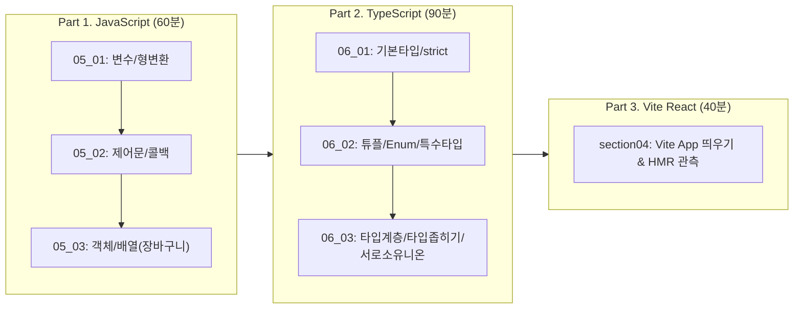

# [실습 & 아키텍처 가이드] 1. JavaScript 핵심 문법, TypeScript 타입 시스템 및 Vite 기초 실습 가이드

이 문서는 **`C:\Users\user\Downloads\practice\daily\07_01`의 1일차 6대 실습 미션(자바스크립트 복습 05_01~03, 타입스크립트 기초/심화 06_01~03, Vite 첫걸음 section04)**을 새로 구성한 `practice_JavaScript` 저장소에서 가장 체계적이고 직관적으로 학습하고 실습할 수 있도록 안내하는 **완성형 실습 가이드**입니다.

Java / Spring MVC에 익숙한 백엔드 개발자의 눈높이에 맞춰 **Java와의 1:1 문법 비교, 터미널 실행 명령어, 각 미션별 요구사항 및 코드 작성 힌트, 셀프 체크리스트**를 상세히 제공합니다.

---

## 📌 목차

1. [1일차 전체 학습 로드맵 및 Java vs JS/TS 패러다임 비교](#1-1일차-전체-학습-로드맵-및-java-vs-jsts-패러다임-비교)
2. [프로젝트 구조 및 실습 준비 파일 배치도](#2-프로젝트-구조-및-실습-준비-파일-배치도)
3. [사전 준비: 패키지 설치 및 실행 환경 점검](#3-사전-준비-패키지-설치-및-실행-환경-점검)
4. [Part 1: JavaScript 핵심 문법 실습 (05_01 ~ 05_03)](#part-1-javascript-핵심-문법-실습-05_01--05_03)
   - [05_01] 변수·상수·자료형·형 변환 (`01_javascript/05_01_basic/basic.js`)
   - [05_02] 연산자·조건문·반복문·함수 분리 (`01_javascript/05_02_control/control.js`)
   - [05_03] 스코프·객체·배열 장바구니 (`01_javascript/05_03_object_array/...`)
5. [Part 2: TypeScript 타입 시스템 실습 (06_01 ~ 06_03)](#part-2-typescript-타입-시스템-실습-06_01--06_03)
   - [06_01] 환경 설정, 기본 타입 & strict 모드 (`02_typescript/src/06_01_basic/...`)
   - [06_02] 배열·튜플·객체·Enum & 특수 타입 (`02_typescript/src/06_02_types/...`)
   - [06_03] 타입 호환성·타입 좁히기·대수 타입·타입 단언 (`02_typescript/src/06_03_advanced/...`)
6. [Part 3: Vite React 첫 화면 실습 (section04)](#part-3-vite-react-첫-화면-실습-section04)
7. [미션별 결과 검증 체크리스트](#7-미션별-결과-검증-체크리스트)
8. [자주 겪는 실수 & 디버깅 가이드 (FAQ)](#8-자주-겪는-실수--디버깅-가이드-faq)

---

## 1. 1일차 전체 학습 로드맵 및 Java vs JS/TS 패러다임 비교



### 💡 Java 개발자를 위한 멘탈 모델 전환표

| 구분 | Java (Spring Boot) | JavaScript / TypeScript |
| :--- | :--- | :--- |
| **타입 결정 시점** | 컴파일 타임에 정적 바인딩 (엄격함) | JS는 런타임 동적 타입 / TS는 컴파일 시점 정적 검사 후 **런타임에는 타입이 증발(Erasure)** |
| **타입 비교 방식** | **명목적 타이핑 (Nominal Typing)**<br>클래스 이름이 같거나 상속 관계여야 호환됨 | **구조적 타이핑 (Structural Typing / 덕 타이핑)**<br>이름이 달라도 가진 프로퍼티(속성) 형태가 같으면 호환됨 |
| **형 변환 / 캐스팅** | `(Integer) obj` (실패 시 `ClassCastException`) | TS의 `as`는 컴파일러에게 "내가 맞으니 참견 마라"는 **타입 단언(Assertion)**일 뿐 런타임 변환 X |
| **타입 가드** | `if (obj instanceof Member) { ... }` | `typeof`, `instanceof`, `in`, 또는 태그 프로퍼티를 이용한 **서로소 유니온(Disjoint Union)** |
| **함수** | 클래스 안의 메서드로만 존재 | 일급 객체(First-class Citizen) ➜ 변수에 대입, 인자로 전달(콜백), 반환 가능 |

---

## 2. 프로젝트 구조 및 실습 준비 파일 배치도

모든 폴더와 기본 스켈레톤(주석 가이드) 파일이 준비 완료되어 있습니다:

```text
practice_JavaScript/
 ├── .gitignore                             [설정 완료] node_modules, dist 등 제외
 ├── package.json                           [설정 완료] Node ESM, typescript, tsx 세팅
 ├── tsconfig.json                          [설정 완료] ESNext, moduleDetection 설정
 ├── docs/
 │    └── guide/
 │         └── 1.JS_TS_DAILY01_PRACTICE_GUIDE.md [본 가이드 문서]
 │
 ├── 01_javascript/                         [Part 1: JS 실습 영역]
 │    ├── 05_01_basic/
 │    │    ├── index.html                   [준비 완료] 브라우저 F12 콘솔 확인용
 │    │    └── basic.js                     [준비 완료] 변수, 상수, 자료형, 형 변환 실습
 │    ├── 05_02_control/
 │    │    └── control.js                   [준비 완료] 학점 계산기, for문, 콜백 함수
 │    └── 05_03_object_array/
 │         ├── scope.js                     [준비 완료] 전역/지역 스코프 비교
 │         ├── user.js                      [준비 완료] 객체 리터럴과 메서드
 │         └── cart.js                      [준비 완료] 장바구니 배열+객체 조작 및 집계
 │
 ├── 02_typescript/                         [Part 2: TS 실습 영역]
 │    └── src/
 │         ├── 06_01_basic/
 │         │    ├── index.ts                [준비 완료] TS 환경 점검 & 원시 타입
 │         │    └── types.ts                [준비 완료] 리터럴 타입 & strict 모드
 │         ├── 06_02_types/
 │         │    ├── arrays.ts               [준비 완료] 배열, 다차원 배열, 튜플
 │         │    ├── objects.ts              [준비 완료] 객체 타입, 선택/readonly, 인덱스 시그니처
 │         │    ├── enums.ts                [준비 완료] 숫자형 Enum, 문자열 Enum
 │         │    └── special-types.ts        [준비 완료] any, unknown, void, never
 │         └── 06_03_advanced/
 │              ├── compatibility.ts        [준비 완료] 타입 계층(업/다운캐스팅), 초과 프로퍼티 검사
 │              ├── type-narrowing.ts       [준비 완료] typeof, instanceof, in 타입 가드
 │              ├── algebraic-types.ts      [준비 완료] 유니온, 인터섹션, 서로소 유니온
 │              └── type-assertion.ts       [준비 완료] 타입 단언(as), const 단언, ! 연산자
 │
 └── 03_vite_react/                         [Part 3: Vite React 실습 영역]
      └── README.md                         [준비 완료] Vite 기본 프로젝트 실행 안내
```

---

## 3. 사전 준비: 패키지 설치 및 실행 환경 점검

터미널을 열고 프로젝트 루트(`practice_JavaScript`)에서 아래 명령을 1회 실행합니다:

```powershell
# 1. TypeScript 컴파일러 및 tsx 실행기 설치
npm install

# 2. 설치 확인
npx tsx -v
```

> 💡 **`tsx`란?**  
> TypeScript 파일을 별도의 복잡한 `tsc` 컴파일 과정 없이 터미널에서 즉시 실행(`npx tsx <경로>`)해 주는 초고속 Node.js 실행 도구입니다.

---

## Part 1: JavaScript 핵심 문법 실습 (05_01 ~ 05_03)

### 📁 [05_01] 변수·상수·자료형·형 변환 (`01_javascript/05_01_basic/basic.js`)
- **실행 명령어**:
  ```powershell
  node 01_javascript/05_01_basic/basic.js
  ```
  *(또는 `01_javascript/05_01_basic/index.html`을 크롬으로 열고 F12 Console 확인)*

#### 📝 작성 미션 & 핵심 힌트
1. **1단계: 변수와 상수**
   - `let name = "홍길동"; const age = 30;` 선언 후 출력.
   - `age = 31;` 재할당 시도 ➜ 콘솔에 `TypeError: Assignment to constant variable.` 에러가 발생하는지 확인.
2. **2단계: 자료형과 템플릿 리터럴**
   - `number`, `string`, `boolean`, `null`, `undefined` 변수 선언.
   - 백틱(`` ` ``)을 사용하여 `${name}(${age}세)은 개발자입니다: ${isDev}` 출력.
   - `typeof null` ➜ `"object"`가 출력되는 자바스크립트 초기 설계 버그 관측!
3. **3단계: 형 변환과 NaN**
   - `"10" + "5"` ➜ `"105"` (문자열 결합)
   - `Number("10") + Number("5")` ➜ `15` (숫자 덧셈)
   - `Number("hello")` ➜ `NaN`
   - `isNaN("hello")`는 `true`이지만, `Number.isNaN("hello")`는 `false`인 차이점(엄격한 검사) 확인.

---

### 📁 [05_02] 연산자·조건문·반복문·함수 (`01_javascript/05_02_control/control.js`)
- **실행 명령어**:
  ```powershell
  node 01_javascript/05_02_control/control.js
  ```

#### 📝 작성 미션 & 핵심 힌트
1. **1단계: 학점 계산기 (if-else & switch)**
   ```javascript
   function getGrade(score) {
     if (score >= 90) return 'A';
     else if (score >= 80) return 'B';
     else if (score >= 70) return 'C';
     else if (score >= 60) return 'D';
     else return 'F';
   }
   ```
2. **2단계: for 문과 제어문 (continue & break)**
   - 1부터 100까지의 합 ➜ `5050`
   - 1부터 100까지 짝수의 합 (`if (i % 2 !== 0) continue;`) ➜ `2550`
   - 누적 합이 200을 넘으면 중단 (`if (sum > 200) break;`) ➜ 20까지 더했을 때 `210`에서 중단
3. **3단계: 콜백 함수 & 최신 연산자**
   - **콜백 함수**: 함수를 인자로 넘겨 출력 포맷을 커스텀:
     ```javascript
     function printGrade(name, score, callback) {
       const grade = getGrade(score);
       callback(name, grade);
     }
     printGrade("철수", 85, (n, g) => console.log(`[통지표] ${n} 학생의 등급은 ${g}입니다.`));
     ```
   - **삼항 연산자**: `score >= 60 ? "합격" : "불합격"`
   - **null 병합 연산자 (`??`)**: `const userName = inputName ?? "게스트";` (null 또는 undefined일 때만 기본값 적용)

---

### 📁 [05_03] 스코프·객체·배열 장바구니 (`01_javascript/05_03_object_array/...`)

#### ① 스코프 실습 (`scope.js`)
```powershell
node 01_javascript/05_03_object_array/scope.js
```
- 함수 스코프 vs 블록 스코프(`let`, `const`는 `{}` 바깥에서 접근 불가: `ReferenceError`).

#### ② 객체 실습 (`user.js`)
```powershell
node 01_javascript/05_03_object_array/user.js
```
- 객체 리터럴: `const user = { name: "홍길동", age: 25, email: "hong@test.com" };`
- 접근법: 점 표기법 `user.name` vs 대괄호 표기법 `user["email"]`
- 프로퍼티 확인: `"email" in user` ➜ `true`
- 프로퍼티 삭제: `delete user.age;`

#### ③ 장바구니 배열 실습 (`cart.js`)
```powershell
node 01_javascript/05_03_object_array/cart.js
```
- 객체 배열 정의 및 총 금액 계산:
  ```javascript
  const cartItems = [
    { name: "노트북", price: 1200000, quantity: 1 },
    { name: "마우스", price: 35000, quantity: 2 },
    { name: "키보드", price: 89000, quantity: 1 },
  ];
  // 총 금액 집계 (reduce 또는 for...of 활용)
  const totalPrice = cartItems.reduce((acc, item) => acc + item.price * item.quantity, 0);
  console.log(`총 결제 금액: ${totalPrice.toLocaleString()}원`);
  ```

---

## Part 2: TypeScript 타입 시스템 실습 (06_01 ~ 06_03)

### 📁 [06_01] 환경 설정, 기본 타입 & strict 모드 (`02_typescript/src/06_01_basic/...`)

#### ① 환경 확인 (`index.ts`)
```powershell
npx tsx 02_typescript/src/06_01_basic/index.ts
```
- `let num: number = 100;`, `let str: string = "TypeScript";`, `let isDone: boolean = true;`

#### ② 리터럴 타입 & strict 모드 (`types.ts`)
```powershell
npx tsx 02_typescript/src/06_01_basic/types.ts
```
- **리터럴 타입**: 오직 특정 값만 허용하는 타입
  ```typescript
  let num: 10 = 10;
  // num = 20; // ❌ 타입 오류 발생!
  type Status = "success" | "error" | "loading"; // 리터럴 유니온
  ```
- **strictNullChecks**: `let text: string = null;` ➜ strict 모드에서는 에러 발생! 유니온 타입(`string | null`)으로 안전하게 처리해야 함.

---

### 📁 [06_02] 배열·튜플·객체·Enum & 특수 타입 (`02_typescript/src/06_02_types/...`)

```powershell
# 각각 tsx로 실행하며 콘솔 및 타입 체크 확인
npx tsx 02_typescript/src/06_02_types/arrays.ts
npx tsx 02_typescript/src/06_02_types/objects.ts
npx tsx 02_typescript/src/06_02_types/enums.ts
npx tsx 02_typescript/src/06_02_types/special-types.ts
```

#### 📝 핵심 코드 가이드
1. **배열과 튜플 (`arrays.ts`)**
   ```typescript
   let list: number[] = [1, 2, 3];
   let tuple: [string, number] = ["홍길동", 20]; // 순서와 길이가 고정된 배열
   // tuple = [20, "홍길동"]; // ❌ 순서 불일치 에러!
   ```
2. **객체 타입과 타입 별칭 (`objects.ts`)**
   ```typescript
   type User = {
     readonly id: number;  // 수정 불가 프로퍼티
     name: string;
     nickname?: string;    // 선택적 프로퍼티 (있어도 되고 없어도 됨)
   };
   type CountryCodes = {
     [key: string]: string; // 인덱스 시그니처 (동적 키-값)
   };
   ```
3. **열거형 Enum (`enums.ts`)**
   ```typescript
   enum Role { ADMIN, USER, GUEST } // 0, 1, 2 자동 할당
   enum Language { KOREAN = "ko", ENGLISH = "en" }
   ```
4. **특수 타입 (`special-types.ts`)**
   - `any`: 타입 검사를 포기함 (위험! 사용 지양)
   - `unknown`: 모든 값을 담을 수 있지만, **타입 좁히기(검사) 전에는 아무것도 할 수 없음 (안전함)**
   - `void`: 반환값이 없는 함수 (`return;`)
   - `never`: 절대 정상 종료되지 않는 함수 (`throw new Error()` 또는 무한 루프)

---

### 📁 [06_03] 타입 호환성·타입 좁히기·대수 타입·타입 단언 (`02_typescript/src/06_03_advanced/...`)

```powershell
npx tsx 02_typescript/src/06_03_advanced/compatibility.ts
npx tsx 02_typescript/src/06_03_advanced/type-narrowing.ts
npx tsx 02_typescript/src/06_03_advanced/algebraic-types.ts
npx tsx 02_typescript/src/06_03_advanced/type-assertion.ts
```

#### 📝 핵심 개념 및 코드 가이드
1. **타입 호환성 & 초과 프로퍼티 검사 (`compatibility.ts`)**
   - TypeScript는 프로퍼티가 더 적은 타입이 **슈퍼타입(부모)**, 더 많은 타입이 **서브타입(자식)**입니다!
   - 서브타입을 슈퍼타입에 대입하는 것은 **업캐스팅(Upcasting ➜ 항상 허용)**.
   - 객체 리터럴을 직접 대입할 때는 정의되지 않은 프로퍼티를 막는 **초과 프로퍼티 검사**가 발동합니다.
2. **타입 좁히기 (`type-narrowing.ts`)**
   ```typescript
   function processVal(x: number | string | Date) {
     if (typeof x === "number") x.toFixed(2);
     else if (typeof x === "string") x.toUpperCase();
     else if (x instanceof Date) x.getTime();
   }
   ```
3. **[핵심] 서로소 유니온 (Disjoint Union) (`algebraic-types.ts`)**
   태그 프로퍼티(`tag`)를 부여하여 switch문에서 완벽하게 타입을 좁힙니다:
   ```typescript
   type Admin = { tag: "ADMIN"; name: string; kickUser: () => void };
   type Member = { tag: "MEMBER"; name: string; point: number };
   type Guest = { tag: "GUEST"; name: string };

   type User = Admin | Member | Guest;

   function login(user: User) {
     switch (user.tag) {
       case "ADMIN": user.kickUser(); break; // Admin 타입으로 완벽 추론!
       case "MEMBER": console.log(user.point); break;
       case "GUEST": console.log(user.name); break;
     }
   }
   ```
4. **타입 단언 (`type-assertion.ts`)**
   - `as` 키워드: `const elem = document.getElementById("root") as HTMLElement;`
   - `as const`: 모든 프로퍼티를 불변(readonly) 및 리터럴 타입으로 고정.
   - `!` (Non-null 단언): `value!.toUpperCase();` (null/undefined가 아님을 개발자가 보증)

---

## Part 3: Vite React 첫 화면 실습 (section04)

`03_vite_react/` 폴더에서 진행하는 첫 리액트 화면 띄우기 실습입니다.

```powershell
# 1. 03_vite_react 폴더 이동
cd 03_vite_react

# 2. Vite React 프로젝트 생성 (자바스크립트 템플릿)
npm create vite@latest . -- --template react

# 3. 설치 및 실행
npm install
npm run dev
```

- 브라우저가 뜨면 `src/App.jsx`를 열어 `<h1>안녕 리액트!</h1>`로 문구를 변경하고 즉시 브라우저가 새로고침 없이 갱신되는 HMR을 체감합니다.

---

## 7. 미션별 결과 검증 체크리스트

모든 실습을 마치고 아래 체크박스를 하나씩 점검해 보세요:

- [ ] `basic.js`: 템플릿 리터럴과 `typeof` 결과가 기대와 일치하는가?
- [ ] `control.js`: 학점 계산기 점수별 분기 및 짝수 합(`2550`)이 정상 계산되는가?
- [ ] `cart.js`: 장바구니 배열의 총 금액이 `reduce`/`for`문으로 정확히 집계되는가?
- [ ] `types.ts`: 리터럴 타입에 잘못된 값을 넣었을 때 TS 컴파일 에러를 관측했는가?
- [ ] `arrays.ts`: 튜플 타입에 순서를 바꿔 넣었을 때 에러가 발생하는가?
- [ ] `special-types.ts`: `unknown` 타입에 타입 가드 없이 접근하면 에러가 뜨는가?
- [ ] `type-narrowing.ts`: `typeof`, `instanceof`로 유니온 타입이 정상적으로 좁혀지는가?
- [ ] `algebraic-types.ts`: 서로소 유니온의 `switch`문 안에서 자동 완성이 올바르게 뜨는가?
- [ ] `03_vite_react`: 로컬 웹 서버(`localhost:5173`)에 리액트 첫 화면이 표시되는가?

---

## 8. 자주 겪는 실수 & 디버깅 가이드 (FAQ)

### Q1. `npx tsx` 실행 시 모듈 오류나 실행 오류가 발생합니다.
> **해결**: 프로젝트 루트(`practice_JavaScript`)에서 `npm install`이 정상 완료되었는지 확인하세요. `package.json`의 `"type": "module"`과 `tsconfig.json`의 `"moduleDetection": "force"` 설정이 적용되어 있어야 합니다.

### Q2. `Cannot redeclare block-scoped variable` 에러가 뜹니다.
> **원인**: 여러 파일에서 `const num = 10;` 처럼 같은 이름의 전역 변수를 선언하면 발생합니다.  
> **해결**: 파일 최상단 또는 최하단에 `export {};`를 적어 해당 파일을 독립된 모듈로 격리하거나, 함수 블록 안에서 선언하세요.

### Q3. `as` 타입 단언을 쓰면 런타임 에러가 안 나나요?
> **주의**: 타입 단언은 **컴파일러의 입을 막는 것**일 뿐, 실제 실행 중인 자바스크립트 값 자체를 변환하지 않습니다. 잘못 단언하면 런타임에 `TypeError`가 발생하므로 반드시 `typeof`나 `instanceof` 같은 **타입 좁히기(타입 가드)**를 우선 사용하는 습관을 들이세요.
